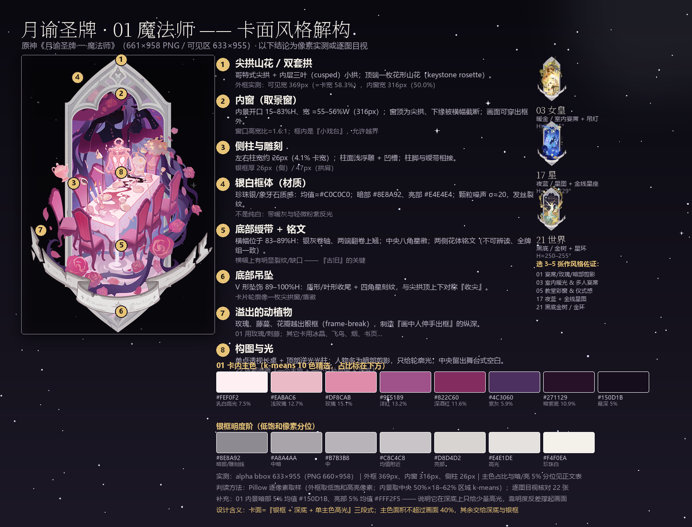
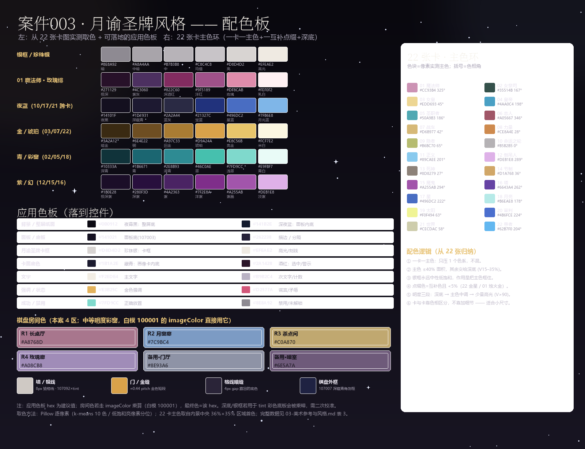
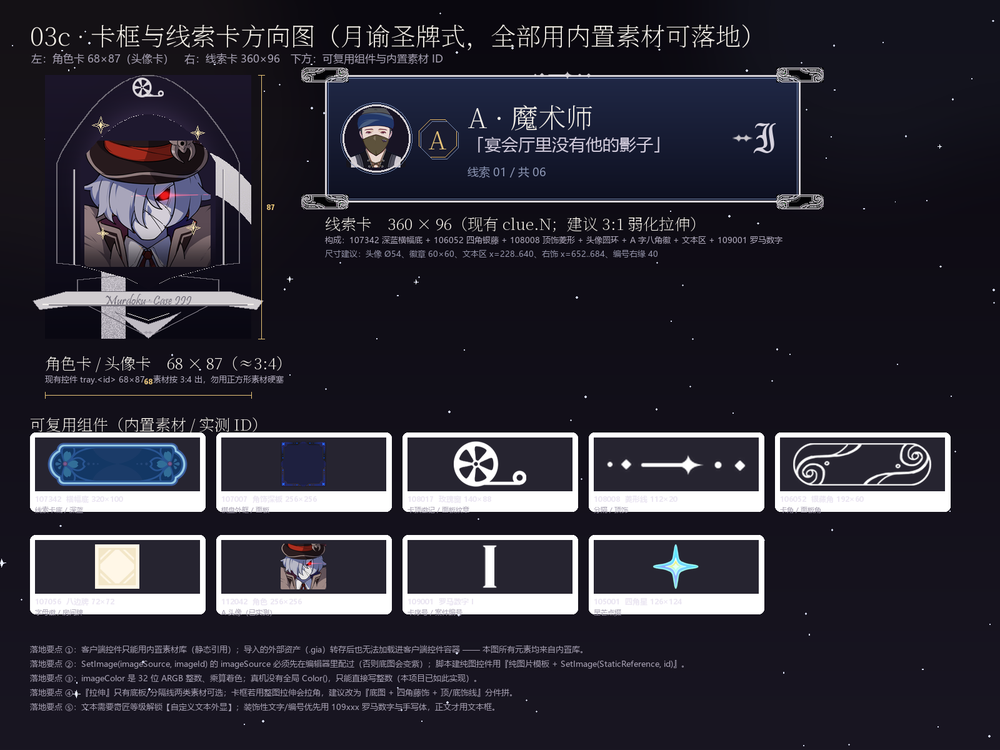
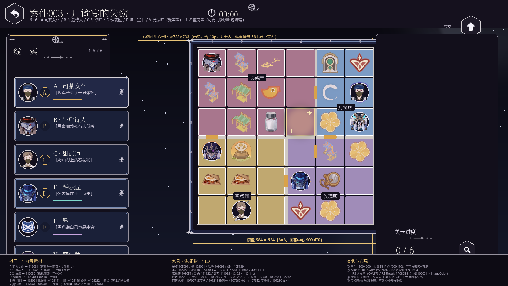
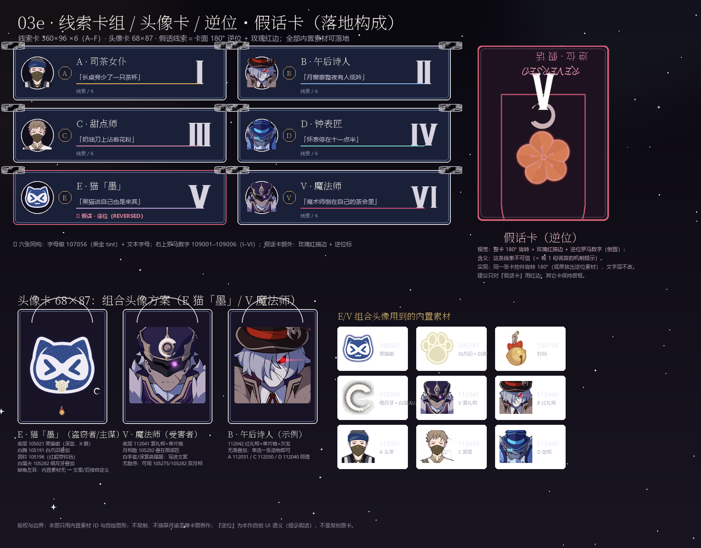

# 03 · 美术参考与风格 —— 月谕圣牌 × 案件003「月谕宴的失窃」

> 项目：千星奇域 UGC 2D 谋杀悬疑推理游戏 Murdoku · 内容设计第三关
> 任务：shared task-3（美术参考分析与「月谕圣牌」风格美术方向）
> 作者：art-analyst　日期：2026-10-19　状态：第一版（可直接给执行者做素材/脚本）
> 写入边界：本文件 + 同目录 03a–03e 五张自生成 PNG 为本人唯一写入物；未改两个仓库的既有文件、未 git commit/push。卡图只作工作区参考，未复制进仓库。
> 上游依赖：02-卡牌考据.md（cards-lore，文本/符号/卡面视觉考据）、qianxing-murdoku 仓的控件坐标表/图片引用文档/素材库缓存、murdoku-复刻规格.md。下游：关卡数据、ui_controller 视觉落地、执行者的素材配置。

**一句话方向**：**把「案卷」换成「一叠月谕圣牌」**——深藏青夜色 + 珍珠银哥特窗框 + 每张卡/每个房间一个主色的彩窗式平涂；棋盘是魔术师长桌的桌布/彩窗地板，线索是一张张圣牌，假话线索是一张**逆位卡**。全部用千星内置素材（1543 张素材库）与自绘示意实现，**不导入外部图、不描摹原卡画作**。

---

## 0. TL;DR（给 Lead / 执行者的 10 条）

1. **参考主图**：`_art/月谕圣牌/01-魔法师.png`（661×958 PNG，可见区 633×955）。22 张已全部逐张看过（见 §2.8 佐证卡），共用同一套「银白尖拱框 + 底部横幅 + V 坠饰」模板，**只有内景换主色**。
2. **风格公式**：银白石质尖拱框（细刻线 + 颗粒 + 裂纹）+ 框内柔和平涂渐变 + 深底（V 15–35%）+ **一卡一主色**（单一色系，主色≤40% 面积）+ 少量高光（V>90）+ 元素穿框 + 无脸/剪影 + 悬浮物。**不是木刻/粗黑线版画**（校准见 02-卡牌考据.md §3.7）。
3. **卡框比例**（与 02 文档 §3.2/3.8 一致，本文复核）：卡 2:3；拱尖 0–2%H；拱肩 10–21%H；**内景开口 15–83%H、宽 55–56%W**；**横幅 83–89%H（x 24.5–75.5%）**；**V 坠饰 89–100%H**；外框可见宽 369px（58.3% 卡宽）、内窗 316px（50.0%）、侧柱 26px。
4. **银框实测**：均值 ≈`#C0C0C0`，暗部 `#8E8A92`、亮部 `#E4E4E4`、高光 `#EFEAE2`；框带亮度均值 178、噪声 σ≈20（颗粒感明显）。01 内景主色：`#DF8CAB`/`#9F5189`/`#822C60`/`#EABAC6`/`#271129` 等，暗部 5% 均值 `#150D1B`、亮部 5% `#FFF2F5`。
5. **落地硬约束**：画布 **1600×900**（设计空间 1920×1080，×5/6）；**6×6 棋盘 584×584 @ (900,470)**（cell 89 / gap 4 / pitch 93）；线索卡 **360×96**、头像卡 **68×87**（3:4）、右栏按钮 70×70。
6. **只能用内置素材**：导入的外部资产（.gia）**只能挂服务器控件、进不了客户端控件容器**；因此卡框/面板/线索卡/头像全部改用 **内置素材 ID + 静态引用 + imageColor 乘算**（脚本 SetImage）。候选 ID 见 §5.10 / 附录 A。
7. **6 枚棋子 → 素材**：A 司茶女仆 `112031`、B 午后诗人 `112042`、C 甜点师 `112030`、D 钟表匠 `112040`、E 猫「墨」`105021`(+`105191` 白胸 +`105196` 铃铛 +`105282` 白尾尖)、V 魔法师 `112041`(+`105282` 月相脸)。**官方素材库没有「黑猫全身」**，E 用「猫脸徽 + 叠加件」组合头像实现（§5.5）。
8. **4 个区域 → 底色**（白模 `100001` × imageColor）：R1 长桌厅 `#A8768D`、R2 月窗廊 `#7C9BC4`、R3 茶点间 `#C0A870`、R4 玫瑰廊 `#A08CB8`；底板候选 `107007 / 107215 / 107269 / 107342 / 107280`。
9. **线索卡构成**：`107342` 深蓝横幅底 + `106052` 四角银藤 + 头像 56–60px + `107056` 八边徽（金 tint）+ 文本 + `109001–109006` 罗马数字；**假话线索 = 整卡 180° 逆位 + 玫瑰红描边**（本作自创语义，不是复刻原卡）。
10. **交付图**：`03a` 卡面解构、`03b` 配色板、`03c` 卡框/线索卡方向图、`03d` 1600×900 落位图、`03e` 线索卡组/头像卡/逆位卡。复现脚本在 `_work/`（不属于交付物）。

---

## 1. 素材清点（每张图是什么、能提供什么）

### 1.1 月谕圣牌卡图（主参考，一手）

| 路径 | 数量/尺寸 | 能提供的信息 | 依据 |
|---|---|---|---|
| `_art/月谕圣牌/01-魔法师.png` … `22-愚者.png` | 22 张；660×958（个别 659–672×956–1024，因画面溢出） | 整副牌的卡框模板、比例、配色逻辑、构图语言、每卡主色 | 逐张 read_image + Pillow 像素测量（§2） |

- 命名：01-魔法师 … 22-愚者，22 张大阿卡纳（原神「月谕圣牌」体系，编号与韦特不同，见 02 文档 §2.8）。
- PNG 带透明通道；**画面是「浮空白底徽章」**，没有矩形卡边（穿框元素可越界）。卡图仅存在于工作区，**未复制进仓库、不在交付物中分发**。

### 1.2 目标游戏 UI 参考（布局/图标原型）

| 路径 | 数量/尺寸 | 能提供的信息 |
|---|---|---|
| `美术参考/*.jpg`（15 张） | 6 张 1920×864 游戏截图（棋盘/线索卡/右栏按钮/进度 0/6）；6 张小图：✓✗、返回、重置（环形箭头）、放大镜 0/9、撤回、返回变体；1 张 1600×900 截图；1 张海报（Early II）；1 张 1024×969 猫表情包（与本任务无关） | 目标玩法界面分区、深色线索卡 + 圆形头像 + 字母徽、房间色块/黑粗墙/暖橙门、深色六边形按钮 + 白图标、米色纸面 + 手绘 sparkle |
| `qianxing-murdoku/docs/美术参考/参考1-布局.jpg`、`参考2-图标与确认键.jpg` | 2 张 1920×864 | 布局定案参考：左线索卡（可滚动）、中棋盘、右竖排按钮、右下「关卡进度 0/6 + 放大镜」；参考 2 多出 ✓✗ 确认卡 |
| `qianxing-murdoku/docs/布局图-关卡内-v3.png` | 1600×900 | 我方 1600×900 布局规划稿（英文标注），可对照控件位置 |
| `qianxing-murdoku/docs/线索卡-设计图*.png`、`线索区-设计图2.png` | 若干 | 线索卡内容排布（头像+名字+线索+字母徽）演化 |

> 注意：`美术参考/` 与 `docs/美术参考/` 是**目标游戏截图**，不是可商用素材；只借鉴分区与信息层级，**不直接搬其图形资产**。

### 1.3 现有游戏素材（占位与 UI）

| 路径 | 内容 | 关键信息 |
|---|---|---|
| `qianxing-murdoku/assets/placeholder/*.png`（23 个） | cell_face 256²、card_face 160×200、portrait_A–V 64²、btn_* 256×96、panel_side 512²、panel_topbar 512×64、x_mark 88²、bg_screen 1600×900 | **长宽比才是硬约束**：头像卡 68×87≈3:4、线索卡 360×96、格子 1:1；有圆角/边框的素材要做九宫格才能拉伸 |
| `qianxing-murdoku/assets/ui/*.png` | 3 张胶囊按钮（深色 1x、米白 1x/3x，520×60 / 1560×180） | 已有按钮素材风格（米白底 + 深色字） |
| `qianxing-murdoku/docs/布局图-关卡内.png`、`布局图-关卡内-v3.png` | 1600×900 | 旧版/新版布局稿 |

### 1.4 现有两关布局图（视觉契约）

| 路径 | 内容 | 能提供的信息 |
|---|---|---|
| `murdoku-project/内容设计-第一阶段-两关布局图/案件001-布局图-v2.png` | 1880×1330 | 5×5：823² 板、墙 11px、门 17×71、外框 13px；四房间色 `#DCE9F7/#DDF0DC/#FBEDD6/#EDE4F7` |
| `…/案件002-布局图-v5.png` | 1880×1420 | 6×6：829² 板；四区域；墙/门规格同族 |
| `…/案件001/002-线索卡高亮提示.png` | 1880×1140 / 1560 | 线索→位置高亮表达 |

> 两张图页脚均注明「本图只表达相对位置与拓扑，不是像素稿」⇒ **比例可照抄，绝对像素不能当规格**。

### 1.5 千星内置素材库（实际可用的素材来源）

| 项 | 内容 |
|---|---|
| 目录缓存 | `qianxing-murdoku/tools/qx/library-catalog.json`：**1543 张 / 14 类**（第三方镜像 qx.070077.xyz；官方总数未公开，镜像缺「自定义素材」类，见 docs/图片引用方式-素材库-头像建在哪.md §12.3） |
| 本地已下载 | `tools/qx/sprites/<分类号>/*.png` **1408 张**；`samples/mono` 95 张白模 |
| 接触表 | `tools/qx/out/sheet-props.png`（道具 139）、`sheet-creation.png`（造物 42）、`sheet-deco.png`/`sheet_deco6.png`（装饰 315）、`cat-3.png`（功能图标 113 带 ID）、`cat-7.png`（特殊字符 73 带 ID）等 |
| 已在用的 ID | `100001`（白方块/格子 face）、`100101`（红 ✗）、`106053`（白模）、`107003`（深色底板）、`107092`（墙/门近白板）、头像 `112042/105104/112031/105105`（tools/qx/known_assets.json 四项独立指标确认） |

分类与 ID 区间（docs/外部资产-怎么用与我做了什么.md §四、图片引用方式 §二）：

| 类 | 数量 | ID 区间 | 本案用途 |
|---|---|---|---|
| 造物（角色/生物半身） | 42 | 112001–112042 | **6 枚棋子头像**（112029–112042 为人物半身；112001–112028 为史莱姆/蕈兽/幽灵/兽面） |
| 道具 | 139 | 111001–111139 | 书/信/卷轴/钥匙/药水/餐具/蛋糕/罐子 |
| 装饰图案-彩色 | 317 | 105001–105317 | 星芒、月牙、玫瑰、花、家具组、猫脸徽、铃铛、爪印 |
| 底板-彩色 | 402 | 107001–107402 | **卡框/横幅/面板/夜空/奖章**（全部逐张扫过：是 UI 底板与装饰，不含场景家具——修正 known_assets 的块级旧说法） |
| 功能图标-单色 | 113 | 100101–100213 | 返回/重置/提交/撤销/提示/时钟/放大镜 |
| 特殊字符 | 75 | 109001–109075 | **罗马数字 I–XII**、花体字母（A/B/C/S）、蓝 3D 数字 |
| 底板-单色 | 96 | 106001–106096 | 白模：圆/方/环/白藤角/渐变遮罩 |
| 分隔线 | 20 | 108001–108020 | 白色细线/菱形串/**玫瑰窗 108017** |
| 玩法图标 | 148+52 | 103001–103148 · 102001–102052 | 元素/盾/时钟/日/骷髅（房间徽记备用） |
| 基础形状 | 6 | 100001–100006 | 白方块（格子 face 在用） |

### 1.6 其他参考/工具

| 项 | 说明 |
|---|---|
| `02-卡牌考据.md`（cards-lore） | 卡面文本、整副牌母题、卡框/配色/规则 10 条、塔罗考据（本文 §3 直接引用，不重复考据劳动） |
| `tools/qx/library.mjs` | fetch / list / sheet --cat= / get --id=；本任务的接触表与单图核对均用它拉图 |
| `tools/qx/known_assets.json` | 头像素材 ID 实测（A=112042/B=105104/V=112031/D=105105 的确认过程与置信度） |
| 外部资产（.gia） | 已实测：能导入/能转存，但**客户端控件容器加载不了外部资产**；只有「转存成客户端控件模板」的少量对象可用（见 转存素材索引.md），且生成后尺寸/内容固定。**本案不依赖外部资产** |

---

## 2. 月谕圣牌卡面风格拆解

### 2.1 22 张共同模板（「套牌感」的来源）

1. **同一套框**：银白/骨白哥特尖拱（柳叶窗/壁龛形）+ 底部银灰卷轴横幅（中央八角星徽）+ V 形坠饰。位置在 22 张上基本一致（个别因溢出裁切尺寸略异）。
2. **一卡一主色**：框恒定冷银；内景只染一个色系（01 洋红/紫；03 金；05 青绿；17 宝蓝；21 金/青；22 湛蓝），**每卡不混色系**。
3. **白底浮空**：不画矩形卡边，场景像徽章浮在纸面。
4. **「画框即舞台」**：内景被处理成「框里的小戏台」；框里/框外两个世界。
5. **框会破**：玫瑰荆棘/烟雾/碎块/飞鸟穿出框；框的完整性可当叙事变量（愚者整框碎裂、月亮框底裂缝）。
6. **无脸/局部人体**：魔法师的头被拱框切掉；女祭司只有一只手 + 黑猫；恋人只有背身舞者；愚者/月亮/世界无人物。**避免正面清晰的脸**。
7. **悬浮语法**：每卡 2–3 件违反重力的小物（茶壶、杯、羽毛、花、像框），表示「魔法正在发生」。
8. **纹样库**：尖拱、菱形/四瓣花、八角星、卷草、荆棘玫瑰、四角星闪光、纸面颗粒；文字只有横幅花体铭文（不可辨读，全牌组相同）。

### 2.2 卡框结构与比例（像素实测量化）

以 `01-魔法师.png`（661×958，可见 bbox 633×955）为准；22 张交叉核对一致（个别卡溢出更高）：

| 构件 | 位置/尺寸（实测） | 说明 |
|---|---|---|
| 卡面 | 660×958（≈2:3；可见 633×955） | PNG 透明底，浮空徽章，无矩形卡边 |
| 尖拱框 | 拱尖 0–2%H；拱肩 10–21%H | 银白骨白石质，多层线脚；拱肩有崩口/裂纹 |
| 拱顶饰 | 拱尖下方正中 | 菱形/曼陀罗镂空 + 四瓣花/蝶形纹 + 两侧尖叶雕饰 |
| **内景开口** | **15–83%H；宽 55–56%W（316px）；x 22.1–77.9%** | 拱形舞台口；场景在其内、可溢出 |
| 外框/侧柱 | 外框可见宽 369px（58.3%）；侧柱 26px（4.1%）；拱肩厚 47px | 左右柱有浅浮雕/凹槽 |
| **横幅 banner** | **83–89%H；x 24.5–75.5%** | 银灰卷轴、两端翻卷上翘；中央八角星徽；左右伪手写铭文 |
| **V 坠饰** | **89–100%H** | 盾形/叶形层叠收尾 + 四角星刻纹，与尖拱顶上下对称 |
| 卡比 | 高/宽 ≈1.51（可见区） | 3:4 头像卡需压缩改版（§5.5/03c） |

> 口径说明：02-卡牌考据.md §3.2/3.8 记录为「内景开口 15–83%H、横幅 83–89%H、V 坠饰 89–100%H」，本文复核结果一致；**勿再用「横幅约占 70%」之类的早先目测值**。

### 2.3 材质与笔触（「石版画/绘本式哥特」，不是木刻）

| 项 | 实测/观察 | 落地含义 |
|---|---|---|
| 银框颜色 | 均值 ≈`#C0C0C0`；暗 `#8E8A92`、中 `#B7B3B8`、亮 `#E4E4E4`、高光 `#EFEAE2`；带轻微暖灰/粉紫反光 | 框用中性色，不与房间主色抢 |
| 框颗粒 | 框带亮度均值 178、σ≈20；横向逐像素差均值 9.24/255 | 要有**细颗粒/纸纹**，不是纯平色 |
| 框刻线 | 细线（1–2px）+ 硬边高光；无粗黑描边 | 纹理只给框/纹样/铭文 |
| 裂纹/缺口 | 拱肩崩口、横幅裂纹、绶带边缘缺口 | 随机位置但样式同族 |
| 内景 | 柔和平涂 + 数字渐变（桌布光、地面光、烟雾），细线甚至无描边 | 内景**不要做粗黑木刻线** |
| 明度 | 深底 V 15–35%；主色中调；少量高光 V>90 | 01 暗部 5% `#150D1B`、亮部 5% `#FFF2F5` |
| 光 | 主光常来自**下方/画面内**（01 桌下光柱、03 室内顶光、17 星图逆光）；人物/背景压暗 | 用渐变遮罩 + 亮部集中做 |

### 2.4 配色与光（01 魔法师取色，供直接抄）

| 区域 | 主色（hex，Pillow 取色） | 用途 |
|---|---|---|
| 外框/横幅 | `#C5C2C3` `#B1ADB2` `#9D929D`；高光 `#E5E2E2` `#DED4D8` | 银白/骨白石质 |
| 背景/帷幕 | `#6B2154` `#682D5C` `#231630` | 深紫—洋红—近黑紫 |
| 人物 | 衣 `#1F142C`；裙/披风 `#692154`；发/手套高光 `#B3A2AA` | 暗紫剪影 + 浅灰紫 |
| 桌布 | `#FEE9ED` `#F0CEDD` `#E2B5CB` `#BF7EAB` `#973D6C` | 白粉→玫粉（最亮处） |
| 中央摆件 | `#FADBE4` `#F1B3C2` `#E49CB6` `#BB719C` | 珊瑚粉，「发光实体」 |
| 地面/光柱 | `#EFD4E6` `#DCBBD1` `#C69BBE` `#6E3A6D` `#A5648E` | 粉白光带 + 紫影 |
| 玫瑰/荆棘 | 花瓣 `#D96A9A–#C74E86`；藤 `#653B6A` | 高饱和洋红点睛 |

> 以上与 02-卡牌考据.md §3.5 一致（其更早一条消息中 `#D96A4E` 为笔误，已更正为 `#D96A9A–#C74E86`，以 02 文档表格为准）。

### 2.5 22 张主色表（一卡一色，用于选「案 003 主色」与线索配色）

| # | 卡 | 主色（实测） | 色相 | # | 卡 | 主色 | 色相 |
|---|---|---|---|---|---|---|---|
| 01 | 魔法师 | `#CC93B4` | 325° | 12 | 倒吊人 | `#DEB1E8` | 289° |
| 02 | 女祭司 | `#35514B` | 167° | 13 | 死神 | `#8D8279` | 27° |
| 03 | 女皇 | `#EDD693` | 45° | 14 | 节制 | `#D1A768` | 36° |
| 04 | 皇帝 | `#4AA0C4` | 198° | 15 | 魔鬼 | `#A255AB` | 294° |
| 05 | 圣职者 | `#50A9B3` | 186° | 16 | 塔 | `#6643A4` | 262° |
| 06 | 恋人 | `#A05667` | 346° | 17 | 星 | `#496DC2` | 222° |
| 07 | 战车 | `#D6B977` | 42° | 18 | 月亮 | `#B6EAE8` | 178° |
| 08 | 力量 | `#CE8A4E` | 28° | 19 | 太阳 | `#F0F494` | 63° |
| 09 | 隐者 | `#B6BC70` | 65° | 20 | 审判 | `#4B6FCE` | 224° |
| 10 | 命运之轮 | `#B5B2B5` | — | 21 | 世界 | `#CECDAC` | 58° |
| 11 | 正义 | `#89CAEE` | 201° | 22 | 愚者 | `#62B7F0` | 204° |

方法：每张内景中央 36%×35% 区域 k-means 首色（`_work/cards_hue.py` 可复现）。**规律：卡与卡靠色相区分，不靠加细节。**

### 2.6 字体/铭文/编号

- 卡面**没有中文牌名、没有可读编号**；牌名在游戏 UI/收藏册显示。
- 横幅铭文是**装饰性花体书写**（疑似伪拉丁/花体拉丁，不可辨读，全牌组一致）⇒ 移植时**只做「伪铭文纹样」**：自创字形/中线花体/无意义连笔；**不要写具体拉丁/中文句**，也别照抄原字形。
- 卡面没有罗马数字；罗马数字是**我们**用来做线索序号/案件编号的风格化元素（用内置 109xxx，见 §5.6）。
- UI 正文字体：千星文本框的字体由引擎决定，且【自定义文本外显】需奇匠等级；**装饰性文字/编号优先用图**（109xxx/108xxx/自绘贴图），正文才用文本框。

### 2.7 象征符号（可安全借用的「风格语汇」）

尖拱（哥特柳叶窗）、菱形/四瓣花、八角星徽、卷草/藤蔓、荆棘玫瑰、四角星闪光、月牙/月相、镜面/圆盘、卡牌扇形、钥匙、纸面颗粒。
> 这些是**通用哥特/塔罗语汇**，不是米哈游独占图形；但**原卡的具体组合（茶会长桌 + 无脸黑衣女 + 珊瑚粉镂空摆件 + 玫瑰荆棘穿框）不要 1:1 复刻**（见 §6）。

### 2.8 选 3–5 张作风格佐证（其余 17 张已逐张看过）

| 卡 | 为什么选它 | 可借的点 |
|---|---|---|
| **01 魔法师**（主参考） | 本案主题卡；室内茶会 + 无脸人物 + 玫瑰荆棘穿框 + 下打光 | 卡框比例、玫瑰/紫主色、四器母题、事件痕迹（打翻茶杯/茶渍） |
| **03 女皇** | 唯一「室内宴席 + 吊灯 + 暖金」的卡 | 长桌厅的暖光与多人宴席构图（本案 R1 长桌厅） |
| **05 圣职者** | 教堂彩窗 + 仪式感 + 青绿主色 | 月窗/彩窗的窗格分割、仪式性站姿、青色主色家族 |
| **17 星** | 夜蓝 + 金色星座线 + 天文仪器 | 月窗廊/观星母题、金线星座可做房间纹样（本案 R2 月窗廊） |
| **21 世界** | 黑底 + 金树 + 金环（最接近「深底 + 金色纹样」） | 完整撑满画面的金线藤蔓/环带，可用于面板底纹与标题装饰 |

---

## 3. 塔罗《魔术师》图像元素（与 02 文档 §4 对齐）

> 说明：本机网络环境无法访问 Wikimedia（已实测超时），**Rider-Waite 原图未落地**；以下元素以公版描述（Waite/De Laurence 1918，属公版）＋ 02-卡牌考据.md §4 的考据为准，仅作**符号**使用，不复制原画。

### 3.1 韦特《魔术师》的图像符号

| 符号 | 含义 | 本案可用方式 |
|---|---|---|
| 头顶 **∞（双纽线）** | 无限、意志的循环 | 变体：双环/8 字结做线索卡角标/标题纹样（**画成自己的环**） |
| **指天 + 指地** | 「As above, so below」/上下呼应 | 构图：月窗（上）与地面魔法阵（下）呼应；UI 的「已确认/未确认」双态 |
| **桌上四花色**：杯、剑、杖（羽毛笔/魔杖）、星币 | 四元素/四工具 | **本案四器**：茶杯、餐刀、羽毛笔、甜点圆盘（与 02 文档 §3.3 的四器一一对应） |
| **白袍 + 红袍** | 纯洁 + 行动/热情 | 配色对标：珍珠银（白）↔ 玫瑰红（红），本案主色沿用 01 的洋红/紫 |
| **玫瑰与百合** | 欲望/纯洁 | 玫瑰用在本案（R4 玫瑰廊），百合改白花（避免复刻） |
| **蛇腰带** | 永恒/自我吞噬 | 可改为「环形藤蔓/月相环」，不做写实蛇 |
| **舞台/表演** | 魔术师＝表演者/骗子原型 | **叙事核心**：魔术师是「被画框吃掉脸的人」；E 猫「墨」是骗子/小偷原型（黑猫＝女祭司卡的星空黑猫意象） |
| 正位/逆位 | 正位＝创造/技能/自信；逆位＝欺骗/操纵/才能误用 | **假话线索=逆位卡**（本作自创 UI 语义）；E 的真身=逆位魔术师 |

### 3.2 原神《月谕圣牌·魔法师》对韦特的改写（本案必须用「原神味」）

- 四花色 → **茶会四器**（杯盏、羽毛笔、餐刀、装甜点的圆盘）＝「小小的秘仪，调和的四质」；
- 宇宙创生 → **一个午后的片刻欢笑**；失窃物可抽象为「一点光/一刻欢笑」（02 文档 TL;DR）；
- 人物**无脸**（头被拱框切掉）；白手套/深紫燕尾服；玫瑰荆棘穿框；桌下光柱+地面魔法阵；
- 猫型捣乱者在同套牌《女祭司》里（星空黑猫）⇒ E「墨」的合法来源。

### 3.3 对案 003 的直接转译（本文采纳）

1. 受害者 V = **魔法师**：深紫燕尾服、白手套、无脸/月相脸（被画框吃脸）→ 头像用 `112041` + `105282` 月相叠加。
2. 盗窃者 E = **猫「墨」**：黑猫、白胸、白尾尖、左耳缺角、自称来宾 → 头像用 `105021`+叠加件（§5.5）。
3. 失窃物：**「一点光」**（月谕宴上的一刻/一枚月相/一枚钥匙）——具体物依文案组定；视觉上用「月相/钥匙/卡牌」三符号承载。
4. 谎言机制：**1 张线索卡逆位**（180° 翻转 + 玫瑰红边），与塔罗逆位语义直接对应。
5. **版权**：RWS 图是公版，但本案**不直接使用**其画面；仅使用符号概念（∞、四器、指天指地）与自创图形。

---

## 4. 现有游戏视觉语言与硬约束

### 4.1 画布与坐标系

| 项 | 值 | 依据 |
|---|---|---|
| 画布（运行时） | **1600×900**，原点左下、Y 向上 | docs/控件坐标表-1600x900.md:12-14 |
| 设计空间 | 1920×1080（左上原点、Y 向下），×5/6 缩放到画布 | 同上 |
| 多画布 | pc-16-9 1600×900、pc-21-9 2100×900、mobile-16-9 1280×720 等 5 种 | docs/社区知识…:118 / docs/Lua坑位清单.md:187-191 |
| 自适应规则 | **禁止按 PC 铺满再在手机上裁切**；应 min(canvas/design) 等比缩放 + 留边 | docs/Lua坑位清单.md:187 |
| 安全边 | 关键内容离画布边 ≥24px（建议）；装饰性元素可出边 | 本方案建议（结合多画布） |

### 4.2 控件几何（画布 1600×900，中心坐标；6×6 最挤一关）

| 控件 | 位置(中心) | 大小 | 备注 |
|---|---|---|---|
| root | 800,450 | 1600×900 | 全屏容器 |
| topbar | 800,857 | 1600×87 | 顶栏（标题/计时/返回） |
| left | 183,427 | 327×733 | 左面板 |
| tray | 183,686 | 300×182 | 头像卡容器（**本案隐藏，头像内嵌线索卡**） |
| clues | 230,399 | 400×544 | 线索面板（可滚动） |
| clue.N | 224, y=610/504/398/292/186/80 | **360×96**（backrop1 360×96，backrop2 354×90） | 6 槽位；第 6 槽默认隐藏/滚动 |
| board/stage | 900,470 | **584×584** | 6×6：cell 89 / gap 4 / pitch 93；外框 ruler 12 |
| right | 1375,427 | 383×733 | 右面板/按钮 |
| 右上按钮 | 1483, 817/721/625 | 70×70 | 提交/重置/撤销（六边形风格） |
| 提示 | 1483,171 | 70×70 | 放大镜 |
| intro/modal | 800,450 | 633×600 | 弹窗 |
| 头像卡 | — | **68×87**（≈3:4） | 现有 tray 卡；本案用于线索卡内头像槽 |

> 数据来源：docs/控件坐标表-1600x900.md:111-171、board-design-contract.md:25-40、assets/placeholder/README.md。
> 文中「右侧 733×733」：按现有硬数据，**棋盘是 584×584 @ (900,470)**；右侧（线索面板右缘 x≈430 到右栏左缘 x≈1183.5）可用方形区约 **753×753**，去 10px 边距≈**733×733**。若 Lead 确要把棋盘放大到 733²，需整体左移并重算格距（cell≈112），属布局变更，需单独确认；**美术方案按现有 584 布局给出**（03d 图同时标出 733 可用区）。

### 4.3 现有视觉语言（两关 + 占位）

| 项 | 现有值 | 依据 |
|---|---|---|
| 纸面/底色 | 米色 `#FDF6E6`（参考游戏采样）；设计稿 `#F6F0E2` | 美术参考/参考1 采样 + 布局图-关卡内-v3 |
| 线索卡 | 深色 `#282622`，圆头像 + 字母徽，白字，选中白描边 | 参考图 |
| 房间色 | 设计图 R1 `#DCE9F7`/R2 `#DDF0DC`/R3 `#FBEDD6`/R4 `#EDE4F7`；代码 ROOM_COLORS（暖木/冷灰蓝/淡紫/淡绿/陶土/石板） | board-design-contract.md:40、ui_controller.lua:4727-4734 |
| 墙/门 | 设计墙 `#111827`/门 `#C2410C`；存档墙 0xFF2B2B33/门 0xFFE2622F；真机实测 `#29282B`/`#DC5B28` | board-design-contract.md:115-118 |
| 墙厚/门长 | 墙 8（设计 11px≈6.9% pitch）；门长比例现 0.30、设计 ≈0.44 pitch | 同上 |
| 占位素材 | cell 256²、card 160×200、portrait 64²、btn 256×96 | assets/placeholder/README.md |
| 字体 | 文本框由引擎渲染；需奇匠等级解锁【自定义文本外显】 | 图片引用方式 §十四 / 控件坐标表 §1 |

### 4.4 图片/素材硬约束（决定方案可行性）

| 约束 | 结论 | 依据 |
|---|---|---|
| 引用方式 | 8 种；**只有「静态引用」能指向内置素材或导入资产**；没有「角色头像」类型 | docs/图片引用方式-素材库-头像建在哪.md:9-39 |
| 外部资产 | 能导入/转存，但**客户端控件容器加载不了外部资产**；只能挂服务器控件、生成时尺寸固定 | 同上 §三/§十二.1、docs/外部资产-怎么用与我做了什么.md |
| 脚本建控件 | 纯图控件可用「纯图片模板 + SetImage(StaticReference, id)」；SetImage 目标必须已有 imageSource（否则底图变紫） | 图片引用方式 §四/§十二.4 |
| imageType | Basic/Stretch 都铺满控件；**只有「底板」「分隔线」两类素材能选拉伸**；素材是「普通」属性时两者无差别 | 图片引用方式 §一/§十二.4 |
| imageColor | 32 位 ARGB 整数、**乘算**；真机没有全局 Color()，只能直接写整数（项目已这样实现）；**整数写入的真机回读仍属未验证项** | engine_adapter_qianxing.lua:105-113,4752-4796 |
| 文本 | 需奇匠等级；**装饰/编号优先用图** | 控件坐标表 §1 |
| 素材库规模 | 本地镜像 1543 张（官方总数未公开）；107xxx 为 UI 底板/横幅类，**不是场景家具**（逐张扫过 382 张确认） | library-catalog.json、_work/art_sheets/scan107_*.png |

> 结论：**所有视觉元素必须落到「内置素材 ID + 静态引用 + 脚本/编辑器配置」**；外部 .gia 仅留作未来非客户端控件（服务器侧）装饰的后路。

---

## 5. 案件003 美术方向提案

### 5.1 总体概念：「月谕宴的失窃」

- **叙事**：魔术师举办「月谕宴」，宴后失窃。受害者 V 魔法师倒在茶会里；6 位来宾/侍者中，猫「墨」自称来宾，实为盗窃者（主谋，可有同伙）。
- **视觉框架**：玩家不是在读案卷，而是在**翻一叠月谕圣牌**——
  - 棋盘 = 魔术师长桌的**桌布格线 / 彩窗地板**；
  - 线索 = **圣牌**（每张牌一个主色、一个器物母题）；
  - 假话 = **逆位卡**；
  - 选中嫌疑人 = **窗框里的画像**。
- **Slogan**：「桌布上的格线，是魔术师留下的谜题；每一张牌，都在替谁说话。」
- **母题**（与 02 文档 §6 对齐）：四器（杯/羽笔/餐刀/甜点盘）、无脸魔术师、镜面空无、猫型骗子、一点光=失窃物。

### 5.2 配色板（完整 hex 见 `03b-案件003配色板.png`）

| 角色 | 色值 | 用途 |
|---|---|---|
| 夜幕黑 | `#0B0912` | 整屏底、棋盘外缘 |
| 深夜蓝 | `#141B2E` | 面板内底 |
| 面板深板 | `#141021` | 面板/线索区底（≈107003 均值 `#272632`，需再压暗） |
| 珍珠银 | `#D8D4D2` / 高光 `#EFEAE2` / 银影 `#8E8A92` | 卡框、银线、描边 |
| 卡面藏青 | `#1B1A2E` | 画像卡内底 |
| 主文字 | `#F2EDE4`；次文字 `#B9B2C4` | 正文/计数 |
| 金色强调 | `#E3B25C`（亮金 `#E8C56B`） | 标题、徽记、进度 |
| 谎言/危险 | `#D2577A`（玫瑰红） | 逆位卡、矛盾提示 |
| 成功/确认 | `#7FD9CC` | 正确放置 |
| 禁用 | `#8E8A92` | 未解锁 |

> 与 01 卡的关系：银框取自卡框实测；玫瑰红/洋红取自 01 主色（`#DF8CAB`/`#822C60`）；金色取自 22/03 的高光/金星；夜色取自 21/17 的深底。

### 5.3 材质与光（三层叠法，UGC 2D 可实现）

| 层 | 素材/手法 | 作用 |
|---|---|---|
| 底 | `107003`（336×256 近纯深板）或 `107007`（256² 深蓝角饰板，拉伸） | 面板/棋盘底色；`107280`（1024×512 夜空+月）做整屏背景 |
| 中 | `100001` 白模 × imageColor（房间色/银线/门金） | 房间底、墙、门、徽记着色 |
| 上 | `106055–106060` 径向渐变（白光/暗角）、`105001/105005` 四角星、`105253` 星芒、`108017` 玫瑰窗、`108008/108019` 菱形串 | 月光光柱、暗角、星芒、雕花 |
| 质感 | 银框用「白模/亮板 + 银色 tint + `106052` 白藤角 + 细线」；颗粒/裂纹可用 1060xx 渐变 + 少量自绘贴图 | 石质框的颗粒/做旧 |

> 光：主光来自**画面内**——月窗（顶光/逆光）或桌面光柱（下打光）；房间内只留金色烛光点（`105153` 茶壶反光/`100124` 时钟金）做对比。

### 5.4 棋盘：4 区域 / 门墙 / 家具（→ `03d` 落位图）

| 区域 | 位置（6×6） | 底色（imageColor） | 家具/象征物（素材 ID） |
|---|---|---|---|
| **R1 长桌厅** | 行 1–3 × 列 1–4 | `#A8768D` 玫瑰灰 | 长桌 `105091`、椅/软垫 `105094`/`105096`、茶壶 `105153`、羽毛笔 `105130`、糖罐 `111018`、茶杯 `111116` |
| **R2 月窗廊** | 行 1–3 × 列 5–6 | `#7C9BC4` 雾蓝 | 月窗 `108017`+`105215`、月 `105281/105282/105275`、玫瑰荆棘 `105300`+`105305`、云 `105133` |
| **R3 茶点间** | 行 4–6 × 列 1–3 | `#C0A870` 淡金 | 蛋糕架 `105059`、甜点 `111122`、餐刀 `111065`（缩 0.6×、银 tint）、盘子 `111116/111118` |
| **R4 玫瑰廊** | 行 4–6 × 列 4–6 | `#A08CB8` 淡紫 | 软垫 `105096`/`105094`、怀表 `105216`、玫瑰藤 `105300`+`105298`+`105305`、铃铛 `105196` |

- **墙**：`107092`（512×256 近白板）× imageColor `#CFC9C4`，厚 8，**骑格线**（中心线公式需先修，board-design-contract.md:126-152）；外框 ruler 12 + `108019` 四角菱形。
- **门**：同 `107092` × `#D9A24A`，长 ≈0.44×pitch（41px，现 0.30 偏短），骑格线、压墙。
- **格线**：4px gap 露底板深色（`#2A2438`），形成「彩窗铅条」感。
- **房间名**：文本 + `107056`（八边牌 72²，tint 银）+ `108008` 分隔线；行/列号用文本或 109xxx 数字。
- **棋盘外框**：`107007`（256² 深蓝角饰板）拉伸 612²；四角 `108019`；如嫌角饰被拉伸，可改「底图 107003 + 四条 108001/108010 银线 + 四角 108019」分件拼。

### 5.5 6 枚棋子（A–E / V）头像方向（68×87 ≈3:4）

> 官方素材库没有「黑猫全身」；E 采用「猫脸徽 + 叠加件」的组合头像（脚本建 2–4 个图片控件叠在卡内，可行）。V 用「礼帽人物 + 月相叠加」实现无脸。

| 棋子 | 造型要点（依 Lead 设定） | 主素材 ID | 叠加/替代 | 备注 |
|---|---|---|---|---|
| **A 司茶女仆** | 女仆头巾、面罩、深色工作装 | `112031`（蓝头带+面罩） | 可加 `105153` 小茶壶做角标 | 现有 V 同款人物，换用途 |
| **B 午后诗人** | 红礼帽、单片镜、灰发、贵族气 | `112042` | 可加 `105130` 羽毛笔角标 | known_assets 确认 A=112042 |
| **C 甜点师** | 橄榄面罩、工作装、朴素 | `112030` | `111122` 蛋糕角标 | 112030 与 112031 同族、无头带 |
| **D 钟表匠** | 蓝礼帽、冷静、机械感 | `112040` | `105216` 怀表/`100124` 时钟角标 | 112040 与 112041/042 同族 |
| **E 猫「墨」** | 黑猫、白胸、白尾尖、左耳缺角、自称来宾 | `105021`（深蓝猫脸徽、X 眼、白描边） | **组合**：`105191` 白爪印（白胸）+ `105196` 铃铛（颈铃）+ `105282` 细月牙（白尾尖）；缺角左耳无内置素材 → 文案/后续自绘 | 备选：`105022`（花纹猫徽）、`105106`（橘猫脸）、`105047`（猫+药水圆徽） |
| **V 魔法师（受害者）** | 深紫燕尾服、白手套、无脸/月相脸 | `112041`（紫礼帽+单片镜） | **叠加**：`105282` 细月牙盖面部（月相脸）；`105275` 蓝月盘作第二方案 | 礼帽＝魔术师符号；白手套写文案 |

实现：头像卡底 `107002`（336×256 浅色角饰板，tint 藏青）或 `107215`（268×320 椭圆卡，tint 珍珠银）；卡内叠头像/叠加件；选中态加 `106032` 白框（tint 银）+ `105001` 星芒。

### 5.6 线索卡 360×96 最终构成（→ `03c` / `03e`）

| 层 | 素材/元素 | 位置/尺寸（100% = 360×96） |
|---|---|---|
| 底 | `107342`（320×100 深蓝藤纹横幅，Stretch）或 `107343`；退化方案：`107003` 深板 + `106052` 四角 | 全卡 0–100% |
| 四角 | `106052`（192×60 白藤角，tint 银） | 四角 18–22% 内 |
| 顶饰 | `108008`（112×20 菱形串，tint 银） | 顶边正中 |
| 头像 | 棋子头像（§5.5），圆环 `106030`（白圆环，tint 银）或 `106032` | 左端 12–60px 见方 |
| 字母徽 | `107056`（72² 八边牌，金 tint）+ 文本字母 A–E/V | 头像右侧 60–88px |
| 文本 | 名字（serif 感，现有文本框）+ 线索句 + 「线索 N / 6」 | 92–330px |
| 编号 | `109001–109006`（罗马数字 I–VI，tint 银） | 右端 330–352px |
| 假话卡 | 整卡 180° 旋转 + 玫瑰红描边 + 逆位罗马数字 + script 花体「REVERSED」贴图 | 仅 1 张 |

- 6 张 = A/B/C/D/E/V；现有槽位 **5 全显 + 第 6 条滚动**（clues.up/down 已实现）。若要求 6 条全显：卡高 96→80、间距 10→8（≈520 总高），需 UI 侧确认。
- **字母徽与罗马数字不同轴**：字母徽 = 角色代号（A–E、V）；罗马数字 = 卡片序号（I–VI，第 5 张是 E、第 6 张是受害者 V）——不要把 E 卡上的「V」误读成角色 V。
- 假话视觉是**本作自创语义**（提示「这条线索不可信」），不是复刻月谕圣牌原卡的任何元素。

### 5.7 UI / HUD

| 控件 | 方案 | 素材 ID |
|---|---|---|
| 顶栏 | 深板 `107003`/`107001`（880×168 星空横幅横拉伸）+ 底边 `108001` 银线 + 中央 `108017` 玫瑰窗 | 107001/107003/108001/108017 |
| 返回/重置/提交/撤销/提示 | 六边形深色底盘（脚本 6 图元拼或 `107241` 四角星板）+ 白图标 | `100109`/`100126`/`100110`/`100127`/`100120` |
| 确认卡 ✓/✗ | `107128`/`107317` 银/青横幅底 + `100102`/`100101` | 107128/107317/100102/100101 |
| 计时器 | `100124` 时钟 + 文本 | 100124 |
| 关卡进度 | 「0 / 6」文本 + `108008` 分隔 + `100120` 放大镜 | 108008/100120 |
| 左面板/线索区 | `107007` 拉伸 400×544（角饰会略变形，可接受）或 `107003` + 四角 `108019` + 顶 `108017` | 107007/107003/108019/108017 |
| 房间铭牌 | `107056` 八边牌（tint 银/金）或 `107123` 奶油八边 | 107056/107123 |
| 选关缩略图 | 房间色块 = `100001` 白模 × ROOM_COLORS（已实现）；卡框 `107215`/`107269` | 100001/107215/107269 |
| 背景 | `107280`（1024×512 夜空+月）拉伸 1600×900 + `106055` 暗角 + `105001` 星芒 | 107280/106055/105001 |

### 5.8 提示高亮 / 选中

| 状态 | 视觉 | 素材 |
|---|---|---|
| 提示（放大镜） | 目标格：`105001` 四角星旋转 + `106055` 径向金光 + 金描边 | 105001/106055 |
| 选中格 | 白框 `106032`/`106039`（tint 银）+ 缩放 1.06 | 106032/106039 |
| 线索卡选中 | 白描边（现有）+ `105253` 星芒角标 + 1.03→1.06 缩放 | 105253 |
| 谎言/矛盾 | 玫瑰红 `#D2577A` 下划线/描边 + 逆位卡 | — |
| 已确认 | `#7FD9CC` 细描边 + 小勾 `100102` | 100102 |

### 5.9 动效与氛围音（低成本、UGC 可实现）

- **动效**：卡牌翻入（rotation/scale，0.25s）、逆位卡翻转（180°，0.4s）、星芒缓慢自转（`105001` alpha 呼吸）、月相流转（`105282`↔`105275` 交叉淡入）、玫瑰瓣飘落（2–3 个 `105300` 小图 particle）、月窗光柱 shimmer（`106058` 渐变 alpha 呼吸）。所有动效只用「已有的 position/scale/alpha 属性」，不新引入渲染机制。
- **氛围音**：八音盒/大键琴/竖琴为主（月谕圣牌/茶会的「古典 + 神秘」）；点缀茶具轻响、纸牌翻动、黑猫铃铛（`105196` 对应音）、门轴、远处雷声/心跳低频（悬疑）。音量分层：环境 -18dB、交互 -12dB、提示 -9dB；谎言揭示时加一记**反转音**（倒放铃声）。
- **注意**：千星客户端 UI 脚本是否能播音频需以引擎能力为准（本文件不假设）；若不能，氛围音挂在关卡/场景音源，与 UI 解耦。

### 5.10 落地映射总表（控件 → 素材 → 颜色/脚本）

| # | 控件/用途 | 素材 | imageColor | 配置方式 |
|---|---|---|---|---|
| 1 | 棋盘外框 | `107007` | 不染（保留深蓝） | 编辑器/脚本建图 + Stretch |
| 2 | 房间底 | `100001` | R1 `#A8768D`/R2 `#7C9BC4`/R3 `#C0A870`/R4 `#A08CB8` | 现有 face + tint 分支（ROOM_COLORS 表） |
| 3 | 墙 | `107092` | `#CFC9C4` | 现有墙控件（imageColor 整数） |
| 4 | 门 | `107092` | `#D9A24A` | 同上 |
| 5 | 家具/象征物 | `105091/105094/105096/105130/105153/105216/105300/105305/105059/105215/105282/111018/111122/111065` | 白/浅 tint | 每格 obj 子控件（visible 开关 + SetImage） |
| 6 | 棋子头像 | `112031/112042/112030/112040/105021(+叠加)` | 白/浅 | assets/portrait.X 或脚本建图 + SetImage(StaticReference, id) |
| 7 | 线索卡底 | `107342`（或 107343/107003+106052） | 不染 | 每张 clue.N 的底板控件（Stretch） |
| 8 | 线索卡装饰 | `106052/108008/107056/109001–109006` | 银/金 tint | 子控件叠层 |
| 9 | 线索卡头像 | 棋子头像 | 白 | 卡内图片子控件 |
| 10 | 顶栏/按钮 | `107003`/`107001`；`100109/100126/100110/100127/100120` | 白图标 + 深底 | 现有 action.* 按钮 |
| 11 | 背景 | `107280` + `106055` + `105001` | 不染/浅白 | 整屏图 + 渐变遮罩 |
| 12 | 文字 | 文本框（引擎字体） | `#F2EDE4`/`#B9B2C4` | 现有文本控件 |

### 5.11 实现路线 / 风险 / 优先级

| 优先级 | 内容 | 风险 |
|---|---|---|
| P0 | 房间色、墙银、门金、线索卡底/四角/徽/头像/罗马数字、背景夜空 | imageColor 整数乘算在真机回读未验证（项目内已在用，需一次真机确认）；107342 拉伸到 360×96 轻微变形（可接受） |
| P1 | 卡框分件（106052+108008+108019）、月窗（108017+105215）、逆位卡旋转、头像组合（E/V） | 组合头像需要脚本建多个图片控件（纯图模板 + SetImage）；旋转 180° 若控件不支持则用「逆位素材/上下翻转贴图」替代 |
| P2 | 面板雕花、房间铭牌、动效、选关卡装饰 | 装饰层多 → 控件数/性能；需性能审计（项目对性能敏感，关键功能清单与性能优化禁区.md） |

> **不改变控件树与坐标**：以上全是「换图/染色/叠装饰层」；两关共用同一套编辑器布局，案 003 不需要新增控件（除可能的组合头像叠加层）。

---

## 6. 「像月谕圣牌但不抄袭」边界清单

### 6.1 可以做（风格语汇，通用）

- 哥特尖拱框、银白/骨白石质（刻线/颗粒/裂纹）、卷轴横幅 + 八角星徽、V 坠饰、一卡一主色、深底 + 少量高光、元素穿框、无脸/剪影、悬浮物、尖拱/菱形/四瓣花/卷草/荆棘玫瑰/四角星/月相/镜面符号、伪铭文纹样（自创字形）、卡 2:3 比例与 15–83% 开口等**比例关系**。

### 6.2 不可以做（法律/版权/原创性）

- ❌ 复制/描摹/二次上色 22 张卡面（工作区仅供看，**不进仓库、不随交付物分发**）。
- ❌ 1:1 复刻 01 的具体构图（茶会长桌 + 无脸黑衣女 + 珊瑚粉镂空摆件 + 玫瑰荆棘穿框的完整组合）。
- ❌ 照抄原卡横幅上的伪拉丁字形/花体铭文；不要写「月谕圣牌」原文文本作为卡面装饰（文本引用限于文档考据）。
- ❌ 使用米哈游角色立绘、logo、专有纹章/元素符号、游戏 UI 贴图。
- ❌ 直接使用 Rider-Waite 原扫描图（虽为公版，可参考不可当成品素材；且与本案风格不符）。
- ❌ 使用目标游戏（美术参考/ 截图）的图形资产；只借鉴信息层级/分区。

### 6.3 操作条款

- 所有成品视觉 = **千星内置素材 ID**（游戏内合法） + **自绘几何/矢量示意**（仅作为方向图，不进游戏）。
- 外部资产（.gia）如未来需要，**只用于服务器控件装饰**，且生成前确认尺寸与版权；本案不依赖。
- 卡面「风格参考」在文档中以文字描述 + 像素测量数据呈现；文档内不嵌入原卡图（本文件只嵌入自生成方向图）。

---

## 7. 方向图（本目录 PNG，全部 Pillow 自生成）

| 文件 | 内容 | 用法 |
|---|---|---|
| `03a-月谕圣牌卡面解构.png` | 01 卡 8 处结构标注 + 3 张佐证卡（03/17/21）+ 主色/银框色阶 | 给执行者看「框怎么长、色怎么分」 |
| `03b-案件003配色板.png` | 22 卡主色环 + 应用色板 + 6 房间色 + 墙/门/框 | 取 hex 直接进代码 |
| `03c-卡框与线索卡方向图.png` | 角色卡 68×87 卡框方案 + 线索卡 360×96 构成 + 组件素材 ID | 给执行者看「卡怎么做」 |
| `03d-棋盘与线索卡落位图.png` | 1600×900 落位：顶栏/左线索 6 卡/棋盘 584²（含 733² 可用区）/右栏；4 区域 + 家具 + 6 棋子 | 布局与素材落位核对 |
| `03e-线索卡与角色卡组.png` | 6 张线索卡（A–E/V）+ 逆位假话卡 + 头像卡（E 猫组合/V 月相脸） | 线索卡/头像最终落地 |

**内嵌预览**（与本文同目录）：

复现（非交付物，脚本在 `_work/`）：`_work/gen_03a.py` … `gen_03e.py`；素材接触表 `_work/art_sheets/scan105_*.png`、`scan107_*.png`、`zoom_candidates.png`；测量脚本 `card_measure*.py`、`cards_hue.py`、`asset_means.py`。

---

## 附录 A：素材 ID 速查（本案可直接用）

| 用途 | ID | 说明 |
|---|---|---|
| 白模/格子 face | `100001` | 基础形状-矩形（256² 白） |
| 深色底板 | `107003` | 336×256，均值 `#272632` |
| 深蓝角饰板/棋盘外框 | `107007` | 256×256，均值 `#1F2242` |
| 近白板（墙/门材质） | `107092` | 512×256，均值 `#F5EDDA` |
| 夜空+月背景 | `107280` | 1024×512 |
| 浅色卡底/面板 | `107002`、`107004`、`107010` | 336×256 / 84×84 / 1024×608 |
| 椭圆卡/卡片/横幅 | `107215`、`107269`、`107342`、`107343`、`107128`、`107317` | 见 03c/03e |
| 八边徽/奖章 | `107056`、`107111`、`107205`、`107354`、`107355`、`107381` | 徽记/房间铭牌 |
| 玫瑰窗/分隔线 | `108017`、`108001/108003/108008/108010/108019` | 白模（tint 银/金） |
| 白藤角/圆环/框 | `106052`、`106030`、`106032`、`106039`、`106050` | 银框分件 |
| 渐变遮罩/暗角 | `106055`、`106058`、`106060` | 光柱/暗角 |
| 四角星/星芒 | `105001`、`105005`、`105253`、`105164–105166` | 点缀 |
| 猫/猫相关 | `105021`、`105022`、`105106`；`105191`、`105196` | E 组合头像 |
| 家具/器物 | `105091`、`105094`、`105096`、`105130`、`105139`、`105153`、`105205`、`105215`、`105216`、`105282`、`105281`、`105275`、`105300`、`105298`、`105305`、`105059`、`105046`、`105048`、`105089`、`105133` | 见 §5.4 |
| 道具 | `111018`、`111020`、`111122`、`111116`、`111118`、`111045`、`111062`、`111063`、`111079`、`111127–111130` | 糖罐/甜点/杯/信/钥匙/书/药水 |
| 头像素材 | `112031`、`112042`、`112030`、`112040`、`112041`、`112029`、`112024` | 人物半身（112029–112042）；幽灵/兽面（112001–112028） |
| 功能图标 | `100109`、`100126`、`100110`、`100127`、`100120`、`100124`、`100102`、`100101` | 返回/重置/提交/撤销/提示/时钟/✓/✗ |
| 罗马数字 | `109001–109006`（I–VI）、`109054–109065`（蓝 3D I–IV） | 卡序号/案件编号 |

> 所有 ID 均来自 `tools/qx/library-catalog.json` 并已下载核对（`sprites/`）；107xxx 类已逐张看过 382 张，确认是 UI 底板/横幅而非场景家具。

---

## 附录 B：视觉契约速查（数字版）

- 画布 1600×900；设计空间 1920×1080（×5/6）。
- 棋盘 584×584 @ (900,470)；6×6：cell 89、gap 4、pitch 93；外框 ruler 12。
- 墙厚 8（骑格线）、门长 ≈0.44×pitch（41px）。
- 线索卡 360×96（backrop1 360×96 / backrop2 354×90）；6 槽位（5 全显 + 6 滚动）。
- 头像卡 68×87（3:4）；现有 tray 容器 300×182。
- 顶栏 1600×87；左面板 327×733；线索面板 400×544；右面板 383×733；按钮 70×70。
- 卡框比例（月谕圣牌）：2:3；拱尖 0–2%H；拱肩 10–21%H；内景 15–83%H；横幅 83–89%H；V 坠饰 89–100%H；开口宽 55–56%W；外框可见 369px、内窗 316px、侧柱 26px。
- 银框色阶：`#8E8A92 → #A8A4AA → #B7B3B8 → #C8C4C8 → #D8D4D2 → #EFEAE2`；颗粒 σ≈20。
- 01 内景主色：`#FEF0F2` 7.5% / `#EABAC6` 12.7% / `#DF8CAB` 15.1% / `#9F5189` 13.2% / `#822C60` 11.6% / `#4C3060` 5.9% / `#271129` 10.9% / `#150D1B`（暗 5%）；亮 5% `#FFF2F5`。

---

## 附录 C：未确认 / 风险（如实标注）

| # | 项 | 影响 | 处理 |
|---|---|---|---|
| 1 | imageColor 整数写法的真机回读 | 房间/墙/门染色是否生效 | 项目已在用同一路径；真机跑一次回读日志即可确认 |
| 2 | 控件旋转 180° 是否支持（逆位卡） | 假话卡视觉 | 退路：单独做「逆位贴图」/上下翻转的图，或只翻转罗马数字与描边 |
| 3 | 组合头像（E/V 多图片叠加） | 头像细节 | 退路：单选一张素材（E=105021，V=112041），细节靠文本描述；或后续自定义 .gia 服务器控件装饰 |
| 4 | 107342 拉伸到 360×96 的变形 | 线索卡底纹 | 可接受（3.2:1→3.75:1）；或用 107003 + 106052 分件 |
| 5 | 文本【自定义文本外显】等级 | 线索文本是否显示 | 沿用现有文本控件（项目已依赖）；装饰文字用图 |
| 6 | 棋盘右缘与右栏 8.5px 重叠 | 观感/点击 | **既有布局事实**（584 @ 900 → 右缘 1192 > 右栏 1183.5）；美术不改布局，仅提示 |
| 7 | 6 条线索全显 | 排版 | 现 5+滚动；要全显需 UI 侧改卡高/间距 |
| 8 | 音频能力 | 氛围音 | 需引擎确认；不假设客户端脚本可播 |

---

## 附录 D：参考与引用

- 一手图：`_art/月谕圣牌/01-魔法师.png` 等 22 张（逐张目视 + Pillow 测量）。
- 考据：`murdoku-project/内容设计-第三关/调研/02-卡牌考据.md`（§3.2 卡框比例、§3.5 取色、§3.6 套牌语言、§3.7 质感校准、§3.8 十条规则、§4 塔罗）。
- 引擎/布局：`qianxing-murdoku/docs/控件坐标表-1600x900.md`（§2 建树顺序/坐标）、`docs/board-design-contract.md`（§1–§5 棋盘/墙/门/色）、`docs/Lua坑位清单.md:187-191`（多画布）、`docs/图片引用方式-素材库-头像建在哪.md`、`docs/外部资产-怎么用与我做了什么.md`、`docs/美术素材从哪来-实地调查.md`、`tools/qx/known_assets.json`、`assets/placeholder/README.md`。
- 参考截图：`qianxing-murdoku/docs/美术参考/参考1-布局.jpg`、`参考2-图标与确认键.jpg`；`美术参考/*.jpg`（15 张）。
- 两关布局：`murdoku-project/内容设计-第一阶段-两关布局图/案件001-布局图-v2.png`、`案件002-布局图-v5.png`。
- 素材库：`tools/qx/library-catalog.json`（1543 条）、`tools/qx/sprites/`（1408 张）、接触表 `tools/qx/out/*.png`。
- 复现脚本（非交付物）：`_work/gen_03a–03e.py`、`_work/card_measure*.py`、`_work/cards_hue.py`、`_work/asset_means.py`、`_work/scan_sheets.py`。
